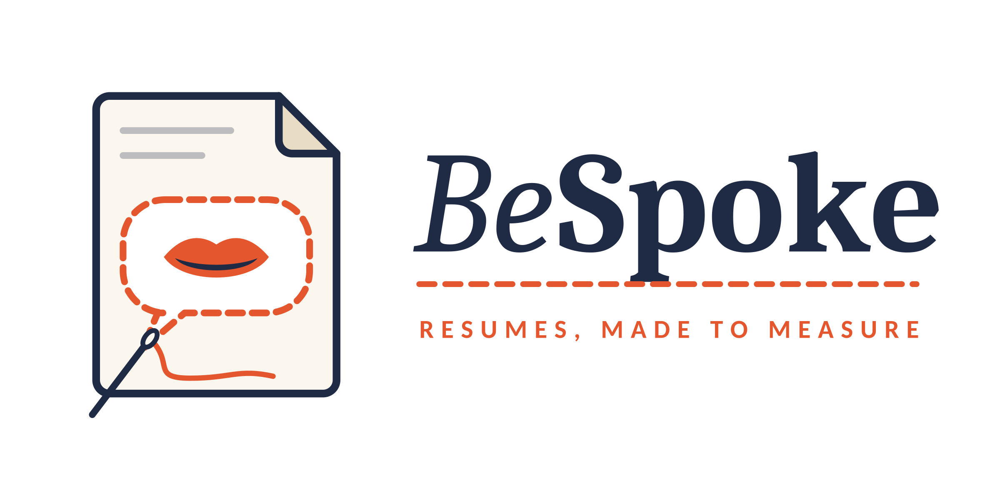

## 🎯 BeSpoke: Resume Tailoring System

> Automatically tailor your resume and generate cover letters for job applications with ATS keyword matching.

---

## ✨ Features

✅ **Smart Resume Tailoring** — Reorders bullets by job relevance  
✅ **ATS Keyword Matching** — See which skills match the job  
✅ **Auto Cover Letters** — Generate professional letters instantly  
✅ **Dual Output** — DOCX + PDF formats (pure Python, no Word/LibreOffice needed)  
✅ **Web App** — Paste a JD in the browser, download everything  
✅ **Honest Reporting** — Never invents skills  

---

## 🌐 Web App (recommended)

```bash
pip install -r requirements.txt
python3 app.py
```

Then open **http://localhost:8000**:

1. Paste the job description
2. Fill in company, role, hiring manager and why you want the job
3. Get the ATS keyword report plus downloads:
   - `Khader_Shareef_Resume_<Company>.pdf` / `.docx`
   - `Khader_Shareef_Cover_Letter_<Company>.pdf` / `.docx`

The **Resume profile** tab lets you edit your content as JSON and saves it to
`profile.json`, which overrides `resume_data.py` for every run (git-ignored).

---

## 🖥️ Command Line

**Step 1:** Edit `resume_data.py` with your information

**Step 2:** Paste job description into `job_description.txt`

**Step 3:** Fill in `job_details.py`:
```python
COMPANY = "Company Name"
ROLE = "Job Title"
HIRING_MANAGER = "Manager Name"
WHY_COMPANY = "Why you want this job"
```

**Step 4:** Generate files
```bash
python3 tailor_resume.py    # → Resume PDF + DOCX + ATS report
python3 cover_letter.py     # → Cover Letter PDF + DOCX
```

Outputs are written to a temp folder; both scripts share the same engine as the web app.

---

## 📁 Files

| File | Purpose |
|------|---------|
| `app.py` | Flask web app (browser UI + downloads) |
| `engine.py` | Run orchestration, profile loading (`profile.json` > `resume_data.py`) |
| `core.py` | Shared tailoring logic + DOCX renderers |
| `pdf_reportlab.py` | Pure-Python PDF rendering (ReportLab) |
| `resume_data.py` | Your resume data (edit once) |
| `job_details.py` | Job-specific info for the CLI |
| `job_description.txt` | Paste JD here (CLI) |
| `tailor_resume.py` | CLI: resume generator |
| `cover_letter.py` | CLI: cover letter generator |

---

## ⚙️ How It Works

1. 📖 Reads job description
2. 🎯 Detects best role title
3. 🔄 Reorders bullets, skills, certs and projects by relevance
4. 📊 Generates ATS keyword report
5. 📄 Outputs DOCX + PDF

---

## ⚠️ Important

- **ATS score** = estimate for THIS job only
- **Never add** skills you don't have
- **Always edit** the cover letter before sending

---

## 👨‍💻 Author

**Khader Shareef**

📧 [infa.khadershareef@gmail.com](mailto:infa.khadershareef@gmail.com)  
🔗 [LinkedIn: Khader Shareef](https://linkedin.com/in/khader-shareef-madani-129167260)  
🌐 [Khader.dev](https://khadershareef19.vercel.app)
